# GYM LOG — PR & Hyrox Tracker

Registro privado de entrenamiento: marcas de fuerza (PR, 1RM, 3RM, 5RM) por ejercicio, tests de
las estaciones de Hyrox y tus carreras HYROX oficiales con todos sus tramos y gráficas. Cada usuario
entra con su cuenta de Google y solo ve sus datos.

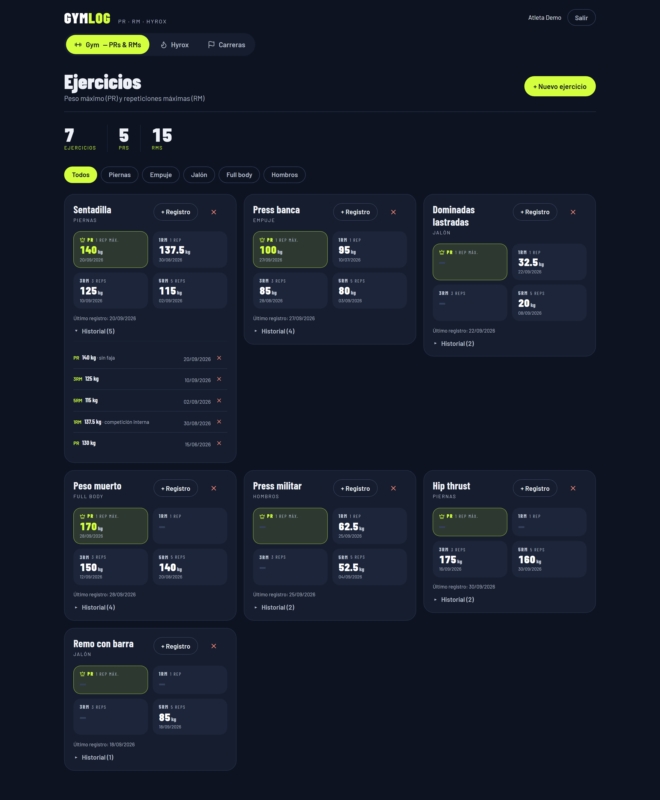

> Todas las capturas usan **datos simulados**: el usuario, los ejercicios, las marcas y los tiempos
> son ficticios. Se regeneran todas con un script ([Capturas](#capturas)).

## Qué hace

- **Gym**: ejercicios por categoría (Piernas, Empuje, Jalón…) en kg o lb. Cada tarjeta muestra el
  mejor PR, 1RM, 3RM y 5RM, la fecha del último registro y el historial con notas. Filtro por
  categoría y resumen (ejercicios, PRs, RMs).
- **Hyrox**: tests por estación (SkiErg, RowErg, Sled Push/Pull, Farmer's Carry, Wall Balls…). Se
  agrupan por estación y distancia/peso; cada grupo muestra la mejor marca, la mejora desde el
  primer test y el historial. Estaciones con nombre libre («Otro»).
- **Carreras**: importa tus resultados oficiales de HYROX desde tu ficha de
  [results.hyrox.com](https://results.hyrox.com/) con un toque en el marcador «Importar en GYM
  LOG» (o copiándola y pegándola). La app lee los 8 runs, las 8
  estaciones, la Roxzone, el total y tus posiciones, y los deja revisables antes de guardar (también
  se pueden meter a mano). Cada carrera tiene su ficha: tiempo oficial, cifras clave, reparto del
  tiempo, gráfica tramo a tramo, ritmo por vuelta, conclusiones, comparación con tus tests de
  entrenamiento y con otra carrera. El listado muestra la evolución, el PB y la mejora entre
  carreras.
- Datos en tiempo real (Firestore): lo que se apunta en el móvil aparece al momento en el
  ordenador.

> **Por qué se pega en vez de buscar automáticamente**: HYROX no ofrece API y reclama sus
> resultados como base de datos protegida (en octubre de 2026 envió requerimientos a las webs que
> los extraían). La app no consulta results.hyrox.com: eres tú quien abre tu ficha oficial y copia
> tus datos.

## Pantallas

### Inicio de sesión

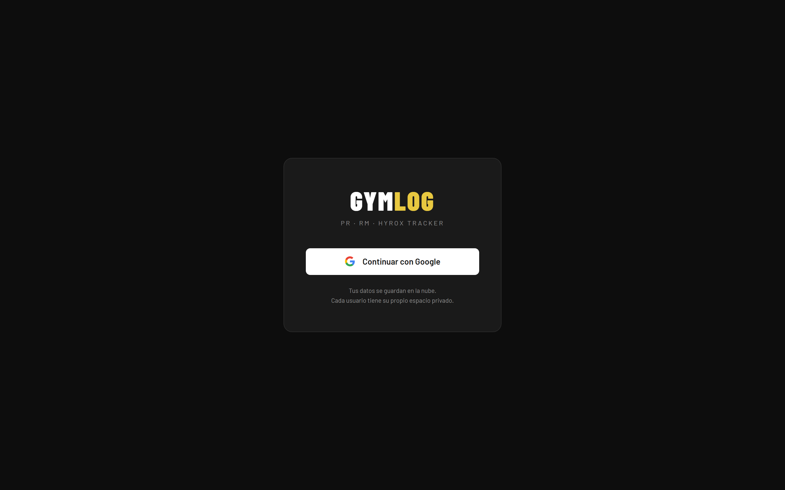

### Gym

Una tarjeta por ejercicio con el mejor peso de cada tipo de registro (el PR, destacado), el último
registro y el historial desplegable. Las categorías filtran la lista.

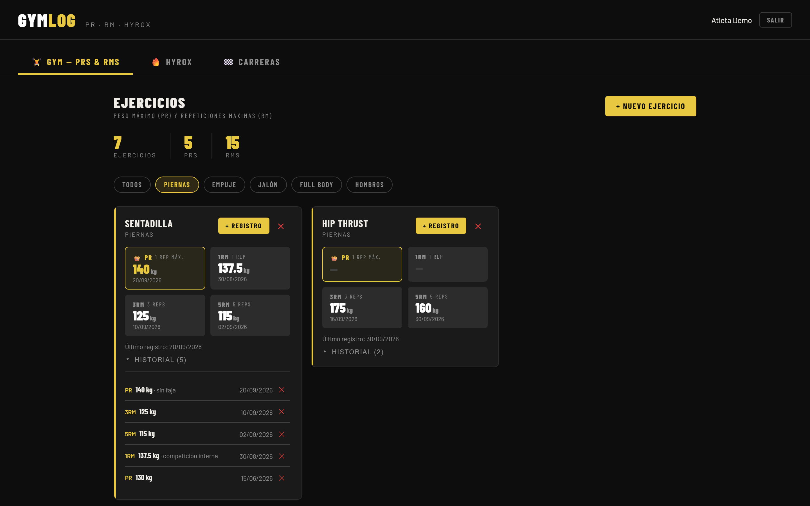

El registro se apunta eligiendo el tipo (PR, 1RM, 3RM o 5RM), el peso, la fecha y una nota:

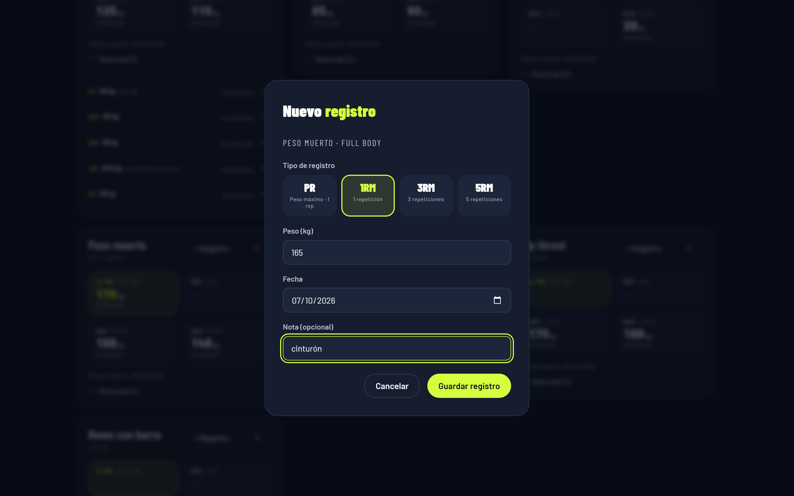

### Hyrox

Los tests se agrupan por estación y distancia/peso. Cada tarjeta muestra la mejor marca y, si hay
más de un test, el badge PB y lo que se ha mejorado desde el primero.

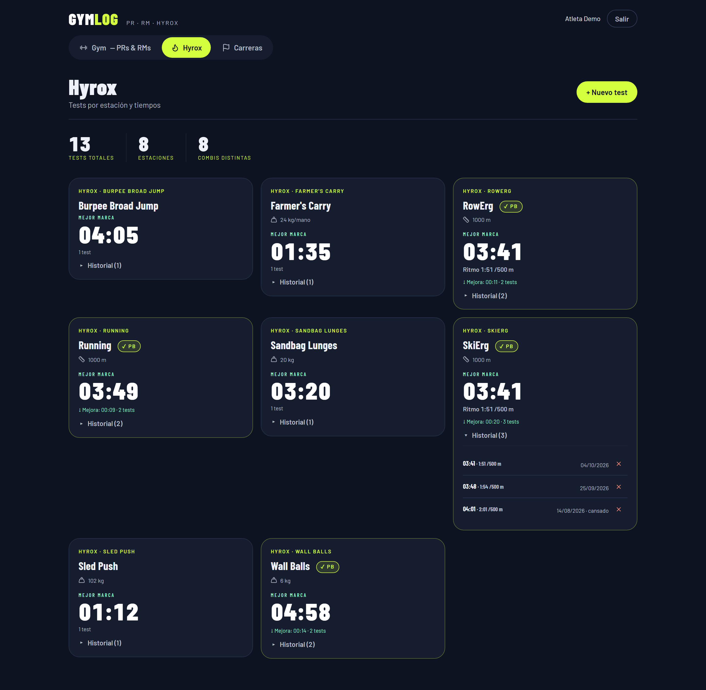

El formulario cambia según la estación: distancia (SkiErg, RowErg, Running), peso (Sled, Farmer's
Carry, Lunges, Wall Balls) con valores habituales o uno escrito a mano, o nada.

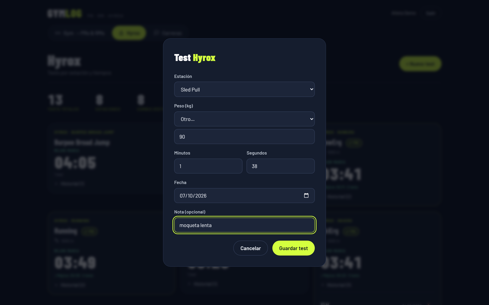

Todo lo que borra pide confirmación:

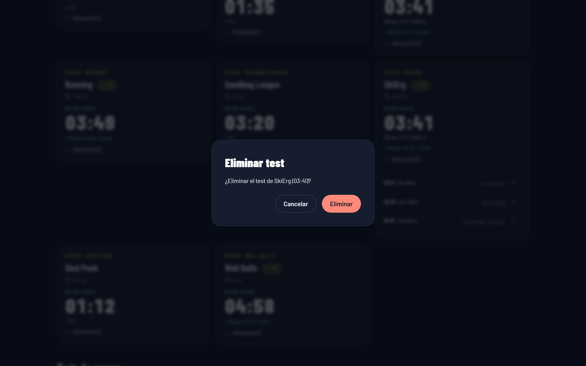

### Carreras

Evolución del tiempo oficial y una tarjeta por carrera, con su posición, el PB de la división, lo
que mejoró respecto a la anterior y una barra con el reparto running / estaciones / Roxzone.

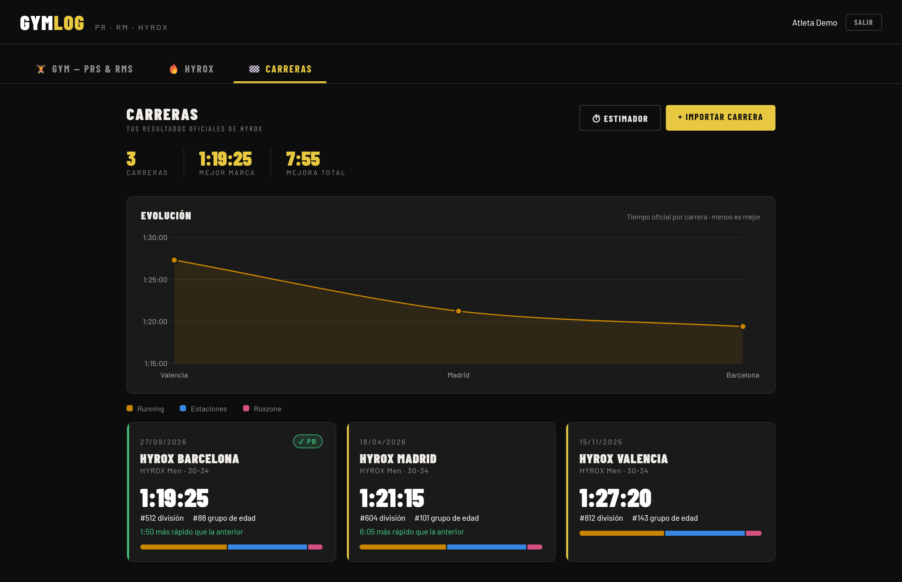

Para importar una carrera se abre la ficha oficial y se pulsa el marcador «Importar en GYM LOG»
(se instala una vez desde esta pantalla: arrastrándolo a la barra de marcadores o, en el móvil,
pegando su código como dirección de un marcador). Es tu navegador quien lee la página que ya estás
viendo y abre GYM LOG con su texto tras el `#` de la dirección, que no llega a ningún servidor.
También se puede copiar la ficha y pegarla. La app indica cuántos tramos ha leído (y cuáles faltan)
y rellena el formulario para revisarlo.

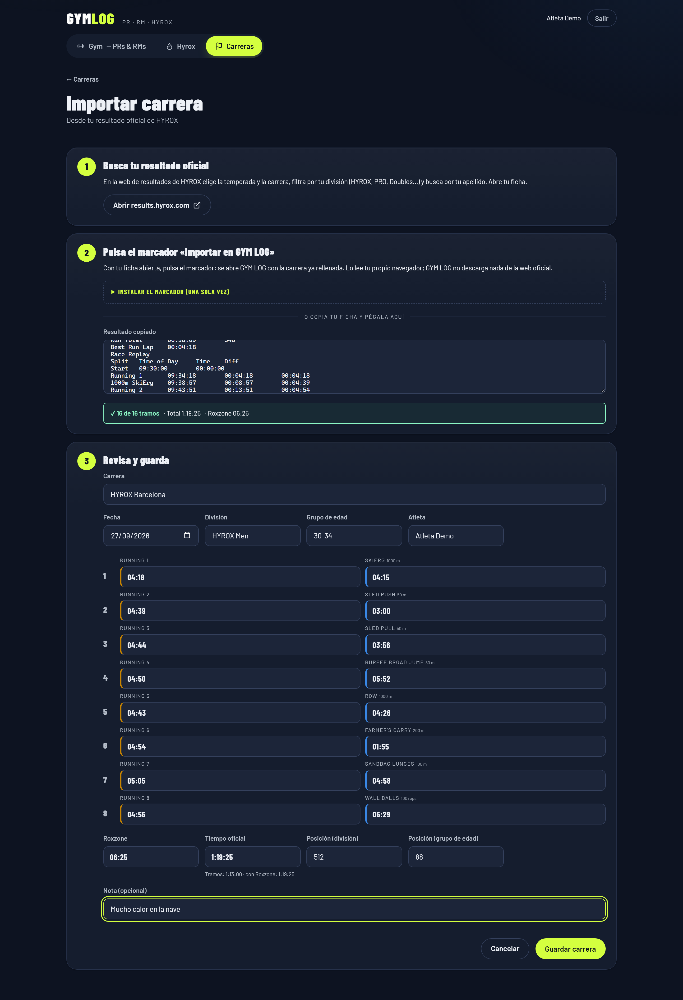

La ficha de la carrera reúne todas las cifras y gráficas:

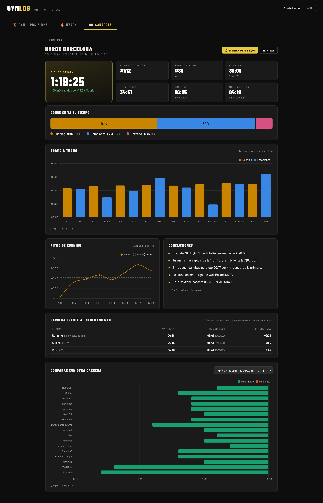

### Estimador de tiempo

Parte de tu última carrera (o de la que elijas, también desde su ficha con «Estimar desde aquí»).
Con deslizadores para el running total, la Roxzone y cada estación calcula el tiempo que harías,
la diferencia con esa carrera, el nuevo reparto y la tabla tramo a tramo. Sin tocar nada da
exactamente el tiempo oficial (absorbe los redondeos de la ficha).

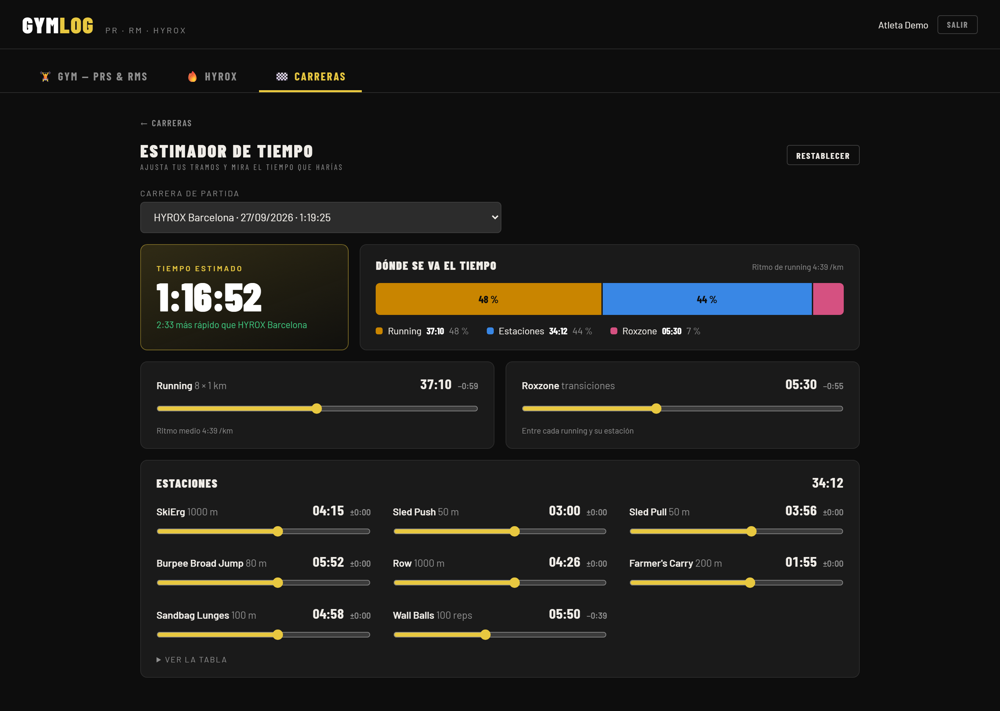

### Móvil

| Gym                                                                       | Nuevo registro                                                                      | Hyrox                                                                         |
| ------------------------------------------------------------------------- | ----------------------------------------------------------------------------------- | ----------------------------------------------------------------------------- |
| 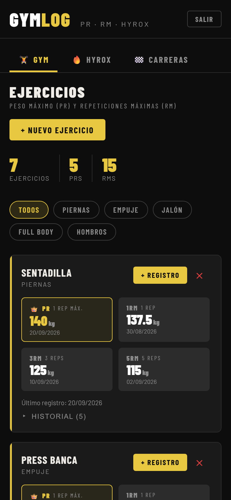 | 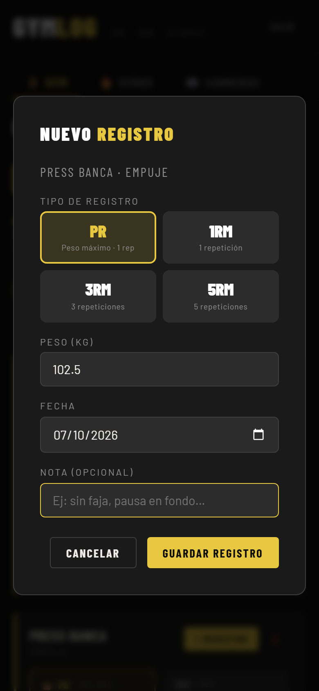 | 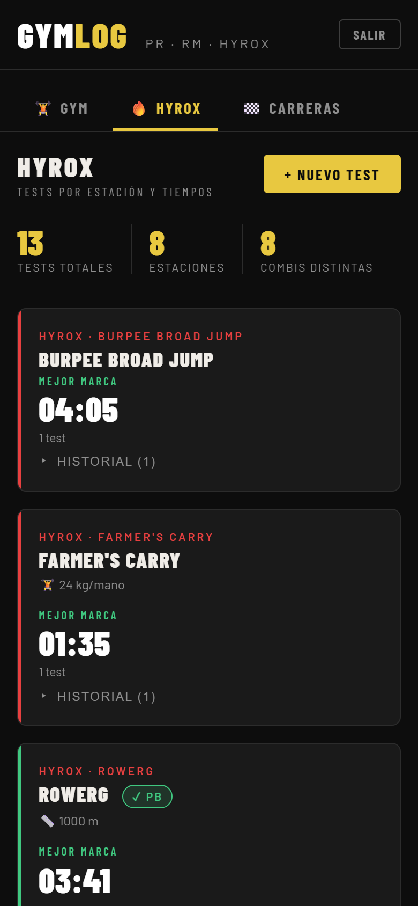 |

| Carreras                                                                            | Ficha de una carrera                                                              |
| ----------------------------------------------------------------------------------- | --------------------------------------------------------------------------------- |
| 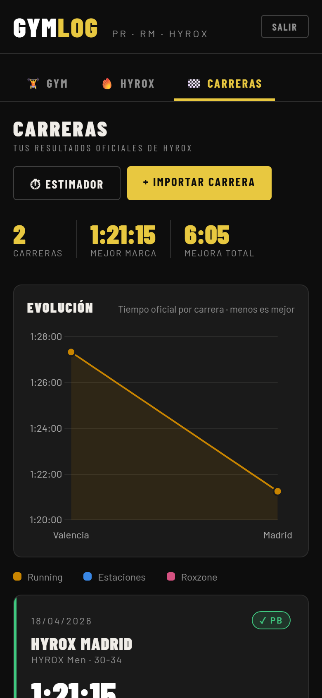 | 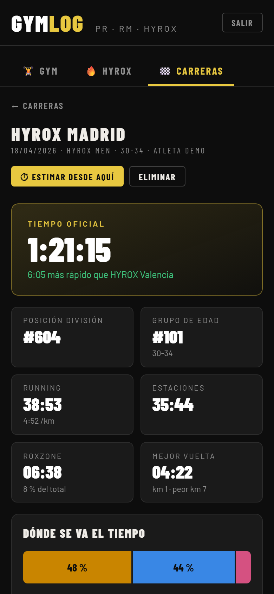 |

## Arquitectura

Angular 22 sin zone.js (signals), componentes standalone `OnPush` y carga diferida por pantalla.
Misma organización que InversionDashboard:

```
src/
├── main.ts · index.html · styles.css    arranque, HTML mínimo y estilos globales
├── environments/                        Firebase real o backend en memoria según el build
├── testing/                             utilidades de los tests y textos de ejemplo pegados
└── app/
    ├── app.ts · app.config.ts · app.routes.ts
    ├── domain/            lógica pura (sin Angular), cada fichero con su spec
    │   ├── records.ts     mejores marcas PR/RM, resumen y filtros de Gym
    │   ├── hyrox.ts       estaciones, agrupación por estación + parámetro, mejoras
    │   ├── race.ts        carreras: tramos, reparto, ritmo, conclusiones, comparaciones, PB
    │   ├── race-import.ts lectura del resultado oficial pegado (por etiquetas, tolerante)
    │   ├── race-forms.ts  formulario de revisión de una carrera
    │   ├── forms.ts       validación de los formularios → datos listos para guardar
    │   └── format.ts      fechas (día local), mm:ss, h:mm:ss, ritmos, diferencias
    ├── core/
    │   ├── models.ts      tipos de los documentos de Firestore
    │   ├── auth/          AuthGateway (abstracta) → Firebase | memoria
    │   ├── data/          TrainingRepository (abstracta) → Firestore | memoria + datos de demo
    │   ├── state/         TrainingStore: datos de la sesión en signals
    │   ├── services/      avisos (toasts), confirmación, títulos, tema de las gráficas
    │   └── providers.ts   elige el backend según el entorno
    ├── shared/            modal, resumen, barra segmentada, gráfica (Chart.js), toasts, pipes
    └── features/
        ├── login/         acceso con Google
        ├── shell/         cabecera, pestañas y pantalla activa
        ├── gym/           pantalla, tarjeta de ejercicio, formularios y GymActions
        ├── hyrox/         pantalla, tarjeta de estación, formulario y HyroxActions
        └── carreras/      listado, importación, ficha, configuración de gráficas y RaceActions
```

Las gráficas usan Chart.js, que se carga solo con la pestaña Carreras (no pesa en el arranque).
Sus colores están validados para el fondo oscuro, con separación suficiente también con daltonismo.

- Los componentes solo pintan; las escrituras pasan por los servicios `*Actions` (validación del
  dominio, confirmación, avisos) y el repositorio.
- El backend en memoria (`environment.e2e.ts`) no viaja en producción: `memory-backend.ts` se
  sustituye por uno vacío en el build.

## Modelo de datos (Firestore)

```
users/{uid}/exercises/{id}              { name, category, unit: 'kg'|'lb', createdAt }
users/{uid}/exercises/{id}/records/{id} { type: 'PR'|'1RM'|'3RM'|'5RM', value, date, note }
users/{uid}/hyrox/{id}                  { station, param: número|null, totalSec, date, note }
users/{uid}/races/{id}                  { event, date, division, ageGroup, athlete,
                                          runs: [8 × s], stations: [8 × s], roxzoneSec,
                                          totalSec, rankOverall, rankAgeGroup, note, createdAt }
```

Fechas `YYYY-MM-DD` (día local); tiempos en segundos. Las estaciones de `stations` van en orden de
carrera: SkiErg, Sled Push, Sled Pull, Burpee Broad Jump, Row, Farmer's Carry, Sandbag Lunges y Wall
Balls. Ejercicios y tests siguen el modelo de la versión anterior: los datos ya guardados se siguen
viendo. Las reglas (`firestore.rules`) solo dejan a cada usuario leer y escribir lo suyo y
limitan tamaños y tipos.

## Desarrollo

Requisitos: Node 24 y npm 11; Java 21 solo para los tests de reglas.

```bash
npm install
npm start              # http://localhost:4200 contra Firebase real
npm run start:demo     # demo con datos de ejemplo en memoria (sin Firebase)
```

| Comando                     | Qué hace                                            |
| --------------------------- | --------------------------------------------------- |
| `npm test -- --watch=false` | Tests unitarios (Vitest)                            |
| `npm run e2e`               | Tests E2E con Playwright (escritorio y móvil, demo) |
| `npm run test:rules`        | Reglas de Firestore en el emulador                  |
| `npm run build`             | Build de producción en `dist/gym-log/browser`       |
| `npm run format`            | Prettier                                            |

## Capturas

Las de este README salen de `docs/capturas/capturas.spec.ts` (Playwright). Se hacen siempre con la
app de demostración (backend en memoria y login simulado, nunca con Firebase ni datos reales):

```bash
npm run capturas                    # todas
npm run capturas -- -g "móvil"      # solo una parte
```

Como la demo trae pocos datos, el script da de alta antes desde la interfaz más ejercicios,
registros y tests Hyrox ficticios (en `capturas.spec.ts`: `EXERCISES`, `RECORDS` y `HYROX`), oculta
los avisos de «guardado» y comprueba que la cuenta en pantalla es la de la demo. Deja las PNG
(escritorio 1440×900 y móvil 390×844, a 2×) en `docs/screenshots/`. Tarda menos de un minuto.

## Despliegue

- **Web**: Netlify la compila y publica en cada push a `main` (`netlify.toml`: `npm run build`,
  carpeta `dist/gym-log/browser`, redirección de rutas a `index.html` y cabeceras de seguridad con
  política de contenido). El dominio de Netlify tiene que estar en Firebase → Authentication →
  Settings → Authorized domains.
- **Reglas de Firestore**: a mano, tras pasar los tests en el emulador (`/deploy-rules` en Claude
  Code o `npx firebase deploy --only firestore`).
- **CI** (`.github/workflows/ci.yml`): formato, unitarios, build, reglas y E2E en cada push.

## Claude Code

`CLAUDE.md` resume las convenciones. En `.claude/`: hooks (confirmación antes de desplegar,
lockfile protegido y Prettier tras cada edición), skills `/nueva-seccion` y `/deploy-rules`, y el
agente `firestore-rules-reviewer`. `.mcp.json` añade los servidores MCP de Angular CLI y Firebase.
